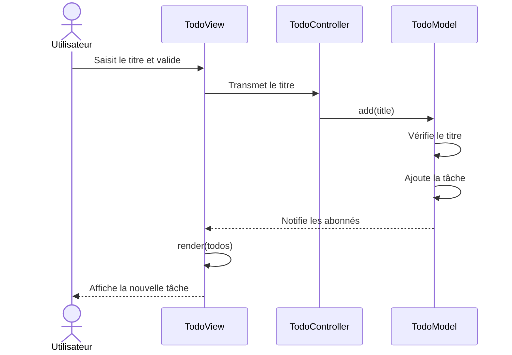
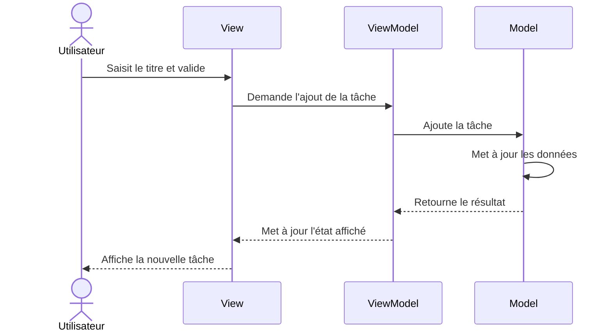

# TP 1 — Étapes 1 et 2

## Étape 1 : Exécution des tests

Les tests des trois exemples MVC, MVP et MVVM ont été exécutés.

- MVC : tests du TodoModel.
- MVP : tests du LoginPresenter.
- MVVM : tests du CartViewModel.

Les tests exécutés sont réussis, sans échec.

## Étape 2 : Diagrammes de séquence

### Diagramme MVC — Ajouter une tâche

### Diagramme MVVM — Ajouter une tâche

